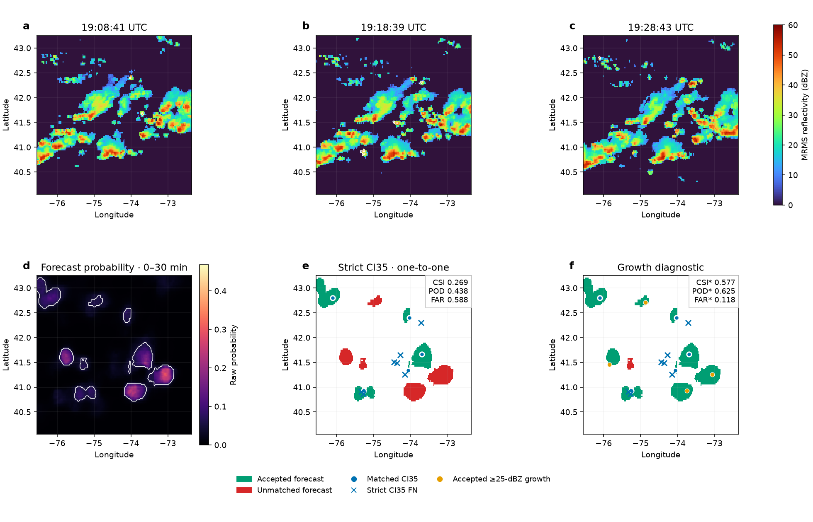

# GOES–MRMS Convection Initiation Nowcasting

*Spatially Explicit Deep Learning Nowcasting of Convection Initiation Using GOES and MRMS*

Marc Crampe<sup>1,2,3,*</sup> · Corey K. Potvin<sup>5,6</sup> · Jacob T. Carlin<sup>5</sup> · Jonathan J. Gourley<sup>5,6</sup> · Derek Stratman<sup>4,5</sup> · Christopher A. Kerr<sup>4,5</sup> · Said A. Mejia Manrique<sup>1,2,3</sup> · Reza Khanbilvardi<sup>1,2,3</sup>

[](https://colab.research.google.com/github/Marccrampe/goes-mrms-ci-nowcasting/blob/main/notebooks/quickstart.ipynb)
[](LICENSE)

[Notebook](notebooks/quickstart.ipynb) · [Model weights](https://github.com/Marccrampe/goes-mrms-ci-nowcasting/releases/latest) · [Data pipeline](docs/pipeline.md)

A residual U-Net combines GOES-East infrared observations and MRMS radar features
to predict convection initiation over the northeastern United States in successive
**0–30- and 30–60-min windows**. The manuscript uses a catalogue of **38,313 CI events**
from selected convectively active periods during 2021–2025.

## Try the demo

Open the Colab notebook for commented manuscript figures, an interactive case
from 25 July 2025 at 19:00 UTC, and radar playback. Explore the probability
threshold, observed-radar persistence, growth-association distance and native
birth-core area. Code and case data load directly from GitHub; no GPU is needed.



The case illustrates object verification. Its single-case scores do not replace
the held-out aggregate results below. All matching uses the full domain before
zoom. The optional notebook section runs the released network on a separate
miniature TEST sample and produces both forecast heads.

**Probability interpretation:** the demo displays raw, uncalibrated sigmoid
scores. Their magnitudes are not calibrated event frequencies. The paper's
isotonic-calibration analysis is separate; no calibration map is silently applied.

## Held-out TEST results

Strict CI35, one-to-one matching within **5 km**, minimum **two forecast-grid
pixels** per forecast object, and **4,712 common TEST issuances**. Operating
thresholds are frozen before TEST; probability thresholds were selected on
VALIDATION. CTC fixed uses its literature reference threshold.

| Model | Window (min) | Threshold | CSI | POD | FAR |
|---|---|---:|---:|---:|---:|
| CTC fixed | 0–30 | 4 K/15 min | 0.020 | 0.201 | 0.979 |
| CTC VAL-selected | 0–30 | 0.5 K/15 min | 0.032 | 0.421 | 0.966 |
| GOES-only ResUNet | 0–30 | 0.040 | 0.093 | 0.215 | 0.859 |
| GOES+MRMS final ResUNet | 0–30 | 0.075 | 0.163 | 0.400 | 0.784 |
| GOES+MRMS final ResUNet | 30–60 | 0.015 | 0.111 | 0.308 | 0.853 |

Exact scores, TP/FP/FN and archived sources are in
[the source-data table](docs/results/main_TEST_results.csv) and
[verification notes](docs/results/README.md). These are archived results,
not scores computed on the demo crop. A trained checkpoint alone is insufficient
to reproduce the complete TEST evaluation; the frozen evaluation cohort and
canonical observations are also required.

The CTC comparison is a satellite cloud-top-cooling baseline. It is **not** a
radar-persistence or radar-extrapolation baseline. The notebook's persistence
control changes a radar-growth verification criterion; it is not a forecast
baseline. No unsupported BSS, extrapolation or external-model scores are reported.

## Model and study design

| Component | Final model |
|---|---|
| GOES-East ABI | C08–C14 at −30, −20, −10 and 0 min: 28 channels |
| MRMS-derived inputs | 18 channels; combined input is 46 × H × W |
| Network | Residual U-Net, width 48, two output heads |
| Training target | Hard support of the soft target, dilated by two model-grid pixels |
| Verification observations | Canonical, uninflated CI35 birth cores |
| Checkpoint | Epoch-20 `last.pt` |

Splits are assigned **by period**, with target proportions 80/10/10 across
training, validation and TEST. All issuances belonging to a period receive its
split. The grouping/search balances event and issuance counts globally and by
year; it is not a future-year holdout. See [split implementation and scope](docs/study_design.md).

The hard +2 representation provides spatial tolerance during training while
verification retains the original CI35 geometry. The six-target ablation in
[Figure 4](docs/figures/Fig04_V1_strict_one_to_one_VALopt_TEST.png) compares the
representations under the same strict evaluation framework. Training dilation
and verification distance are separate settings.

## Install and run locally

Use Python 3.11 or later from the repository root:

```bash
python -m venv .venv
source .venv/bin/activate
python -m pip install -e ".[demo,model]"
python notebooks/run_quickstart.py
python -m unittest discover -s tests -v
```

Download `goes_mrms_ci35_hard_r2_public.pt` from the linked GitHub Release and place it
in `weights/` before running the local quickstart. The notebook can download it
automatically. The ~103-MiB file is a Release asset, not a Git source file.
Required SHA-256:

```text
9bc69822fb18d9b5036bc4e90fa7487aa08aafdaeda364ebb176fc55b01d5b0b
```

For catalogue reconstruction, satellite/radar processing and training:

```bash
python -m pip install -e ".[pipeline]"
python pipeline.py list
python pipeline.py configure
```

Follow [the ordered pipeline](docs/pipeline.md). Use `CI_WORKSPACE` for data and
outputs; configure final training inputs in `configs/final_model.json`.
Training requires the prepared dataset and a suitable CUDA GPU. The binary20/QC
stages preserve the original paired-cohort preparation and review decisions;
binary20 is not the final model's training target.

## Reproducibility and limits

Local validation covers numerical tests, original-case regression, notebook
controls, stage entry points and real checkpoint inference on the miniature
sample. It does not establish a fresh end-to-end catalogue rebuild or a completed
20-epoch CUDA reproduction. Details are in [validation scope](docs/validation.md).

The 38,313-event catalogue, original period splits and QC records have been
prepared for a separate Zenodo deposit; that deposit is currently a draft. [Data availability](docs/data_availability.md)
lists the outstanding assets. No dataset DOI or complete regeneration claim is
made on the strength of a miniature example.

## Data, licensing and citation

GOES ABI and MRMS source attribution, transformations and source-policy links:
[DATA_ATTRIBUTION.md](examples/DATA_ATTRIBUTION.md).
Original software: **[MIT License](LICENSE)**. Dataset, figure and source-data
terms are separate; see [licensing and attribution](docs/licensing.md).

Use [CITATION.cff](CITATION.cff) for authorship and title. A versioned code/data
archive and DOI can be added once actually published. Correspondence:
[Marc Crampe](mailto:mcrampe@ccny.cuny.edu).

<details>
<summary><strong>Author affiliations</strong></summary>

1. Department of Civil Engineering, The City College of New York, City University of New York, New York, NY, USA.
2. CUNY CREST Institute, The City College of New York, New York, NY, USA.
3. United Nations University (UNU) Hub on Remote-Sensing and Sustainable Innovations for Resilient Urban Systems (R-SIRUS) at the City College of New York, United Nations University Institute for Water, Environment and Health (UNU-INWEH), New York, USA.
4. Cooperative Institute for Severe and High-Impact Weather Research and Operations, The University of Oklahoma, Norman, OK, USA.
5. NOAA/OAR National Severe Storms Laboratory, Norman, OK, USA.
6. School of Meteorology, The University of Oklahoma, Norman, OK, USA.

</details>

