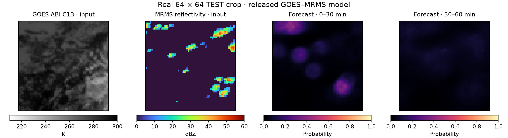

<div align="center">

# GOES–MRMS Convection Initiation Nowcasting

**Satellite and radar observations → spatial CI probability maps → two forecast windows**

*Spatially Explicit Deep Learning Nowcasting of Convection Initiation Using GOES and MRMS*

Marc Crampe<sup>1,2,3,*</sup> · Corey K. Potvin<sup>5,6</sup> · Jacob T. Carlin<sup>5</sup> · Jonathan J. Gourley<sup>5,6</sup> · Derek Stratman<sup>4,5</sup> · Christopher A. Kerr<sup>4,5</sup> · Said Mejia<sup>1,2,3</sup> · Reza Khanbilvardi<sup>1,2,3</sup>

[](https://colab.research.google.com/github/Marccrampe/goes-mrms-ci-nowcasting/blob/main/notebooks/quickstart.ipynb)
[**View the demo notebook**](notebooks/quickstart.ipynb) · [**Download model weights**](https://github.com/Marccrampe/goes-mrms-ci-nowcasting/releases/latest) · [**Reproduce the pipeline**](docs/pipeline.md)

</div>

## Try the model first

Open the **Colab demo** above to load the released model, run CPU inference on
a real miniature TEST sample, and explore the input history and forecast windows.
The notebook downloads the checkpoint from this repository's latest published
Release and verifies its SHA-256. No GPU is needed for this demonstration.



*Real 64 × 64 TEST crop and raw model probabilities. This is an execution
demonstration, not a full-domain case-study verification or a calibrated product.*

## About the paper

Correspondence: [Marc Crampe](mailto:mcrampe@ccny.cuny.edu).

This repository accompanies our research on forecasting where new convection
will develop over the northeastern United States. The manuscript describes a
catalogue of **38,313 radar-identified CI events from selected periods in
2021–2025**, and a residual U-Net combining GOES-East infrared observations
with MRMS radar information. The model produces spatial forecasts for successive
**0–30- and 30–60-min windows**.

The release focuses on the **final GOES+MRMS model and its data pipeline**.
The paper's full comparison experiments and figure-generation history are not
required to use it. A paper/preprint link and publication information can be
added here when available; no publication status is assumed.

<details>
<summary><strong>Author affiliations</strong></summary>

1. Department of Civil Engineering, The City College of New York, City University of New York, New York, NY, USA.
2. CUNY CREST Institute, The City College of New York, New York, NY, USA.
3. United Nations University (UNU) Hub on Remote-Sensing and Sustainable Innovations for Resilient Urban Systems (R-SIRUS) at the City College of New York, United Nations University Institute for Water, Environment and Health (UNU-INWEH), New York, USA.
4. Cooperative Institute for Severe and High-Impact Weather Research and Operations, The University of Oklahoma, Norman, OK, USA.
5. NOAA/OAR National Severe Storms Laboratory, Norman, OK, USA.
6. School of Meteorology, The University of Oklahoma, Norman, OK, USA.

</details>

## What the final model does

| Input / output | Description |
| --- | --- |
| GOES-East ABI | C08–C14 at −30, −20, −10 and 0 min: 28 channels |
| MRMS-derived inputs | Reflectivity, validity, threshold and temporal-difference features |
| Combined model input | 46 channels on the GOES model grid |
| Network | Residual U-Net |
| Training target | Hard support of the original soft target, dilated by two model-grid pixels |
| Outputs | CI probability maps for (0,30] and (30,60] min |

The supplied demonstration displays **raw sigmoid probabilities**. The separate
isotonic-calibration analysis discussed in the paper is not applied by this demo.

## Run locally

Python 3.11 or later. From a source checkout:

```bash
python3 -m venv .venv
source .venv/bin/activate
python -m pip install -r requirements-demo.txt
```

Download `goes_mrms_ci35_hard_r2.pt` from the
[latest published Release](https://github.com/Marccrampe/goes-mrms-ci-nowcasting/releases/latest)
and place it in `weights/`. Alternatively, the notebook can download and verify
the asset automatically.

```bash
python notebooks/run_quickstart.py
python -m unittest discover -s tests -v
```

The **309-MiB checkpoint is distributed as a Release asset**, separately from
the source tree. Its required SHA-256 is:

```text
9231c9bb9aa540717986c1ae729cdbbf56629ed74b072de10a200be4f9ae507e
```

## Rebuild the catalogue and train

The workflow covers native MRMS acquisition and period construction, GOES
retrieval, parallax correction and fill, strict CI35 catalogue construction,
dataset/QC preparation, and final-model training.

```bash
python -m pip install -r requirements.txt
python pipeline.py list
python pipeline.py configure
```

Follow **[the ordered pipeline guide](docs/pipeline.md)** and
[data prerequisites](docs/data_prerequisites.md). Data/output storage is selected
with `CI_WORKSPACE`; training input paths are set in `configs/final_model.json`.

```bash
python models/train.py --config configs/final_model.json --check-only
python models/train.py --config configs/final_model.json --smoke
# Select a new empty run_dir after the smoke test.
python models/train.py --config configs/final_model.json
```

Training requires a **CUDA GPU and the complete prepared dataset**. The main
checkpoint is epoch-20 `last.pt`. Historical binary20/QC stages remain prerequisites
of the paired-cohort preparation; binary20 is not the final hard+2 training target.

<details>
<summary><strong>Repository map</strong></summary>

| Directory | Contents |
| --- | --- |
| `catalogue/` | Period construction, strict events and quality checks |
| `preprocessing/` | GOES/MRMS processing and dataset loader |
| `models/` | Architecture, training and inference |
| `workflow/` | Shared scientific implementation |
| `configs/` | Final-model settings and catalogue templates |
| `notebooks/` | Interactive demonstration |
| `examples/` | Real miniature inputs and provenance |
| `weights/` | Location for the separately downloaded checkpoint |
| `verification/` | Optional numerical scoring utilities |
| `provenance/` | Original sources, training configuration and QC evidence |
| `docs/`, `tests/` | Instructions and validation |

</details>

## Reproducibility status

The core release passed local numerical tests, real checkpoint inference,
stage startup checks, and the recovered binary20/QC selftests. The miniature
example supports CPU execution independently of the cluster.

Full raw-data downloads, complete catalogue regeneration, human review and the
20-epoch CUDA run have **not** been repeated in the local release validation.
See [validation scope](docs/validation.md). Human QC choices and dataset identity
must be preserved explicitly when reproducing the original study.

<details>
<summary><strong>Manuscript citation information</strong></summary>

```bibtex
@misc{crampe_goes_mrms_ci_nowcasting,
  title = {Spatially Explicit Deep Learning Nowcasting of Convection Initiation Using GOES and MRMS},
  author = {Crampe, Marc and Potvin, Corey K. and Carlin, Jacob T. and Gourley, Jonathan J. and Stratman, Derek and Kerr, Christopher A. and Mejia, Said and Khanbilvardi, Reza},
  url = {https://github.com/Marccrampe/goes-mrms-ci-nowcasting},
  note = {Companion research code; publication metadata to be added when available}
}
```

</details>

## Data and licence

Review `examples/DATA_LICENSE_REVIEW_REQUIRED.md` for the miniature sample's
redistribution/attribution review. The authors' chosen code licence should be
provided in `LICENSE` before an open-source licence is advertised.
